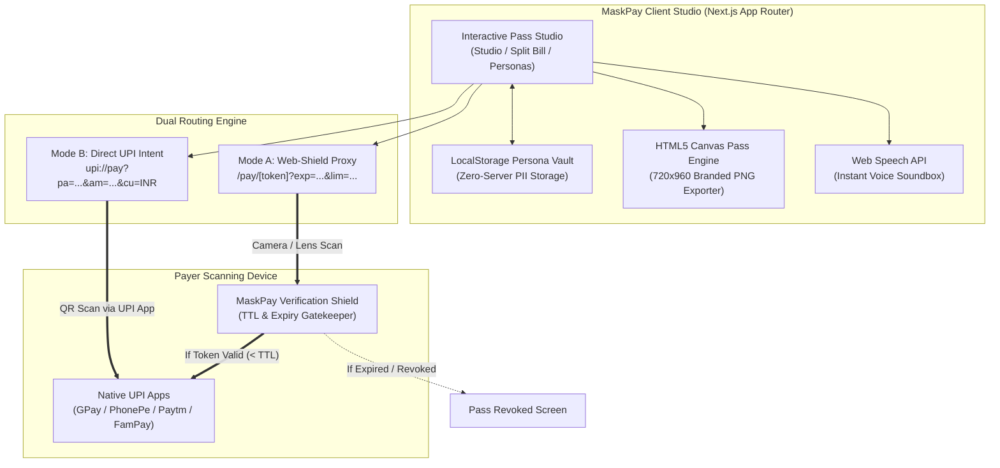
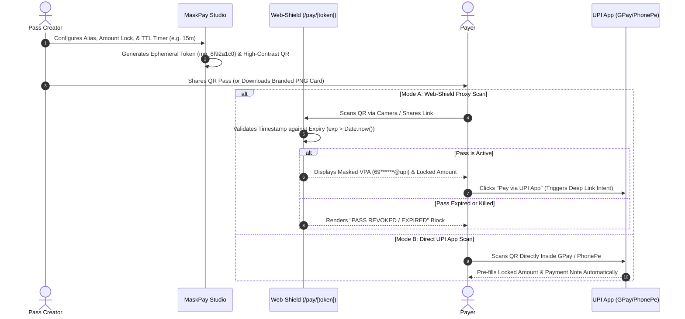

<div align="center">

# MaskPay — Dynamic UPI Privacy Studio & Pass Generator

**Stop exposing your raw static UPI QR in public. Mint auto-expiring, amount-locked, multi-persona UPI passes in seconds.**

[](https://maskpay-umber.vercel.app/dashboard)
[](https://nextjs.org/)
[](https://www.typescriptlang.org/)
[](https://tailwindcss.com/)
[](./LICENSE)

[**Launch Live Studio**](https://maskpay-umber.vercel.app/dashboard) • [**Connect with Author on LinkedIn**](https://www.linkedin.com/in/codenameharsh07/)

</div>

---

## Problem Statement

In India's UPI ecosystem, sharing a static QR code on storefronts, freelance invoices, livestreams, or classified listings permanently exposes your **raw Virtual Payment Address (VPA)**—frequently tied to your personal mobile number—to anyone with a scanner.

Standard banking QRs also lack:
- **Session Expiry (TTL):** Once shared on WhatsApp or Discord, a static QR remains valid forever.
- **Locked Per-Head Split Calculation:** Splitting a group restaurant bill requires manual math.
- **Persona Switching:** Freelancers and creators juggle personal, studio, and group collection aliases manually.

**MaskPay** solves pre-transaction exposure and static QR limitations through a client-side cryptographic pass studio.

---

## System Architecture & Flowcharts

### 1. High-Level Component & Routing Architecture



---

### 2. End-to-End Payment Pass Lifecycle (Sequence Flow)



---

## Core Features & Engineering Matrix

| Module | Capability | Engineering Implementation |
| :--- | :--- | :--- |
| **Dynamic QR Pass Studio** | Real-time generation of scannable UPI passes with custom display aliases, locked rupee amounts, and transaction notes. | Built on `qrcode` canvas data-URI encoding with Medium (`M`) error-correction for instant dark/light contrast recognition. |
| **Ephemeral TTL & Kill Switch** | Auto-rotates pass tokens every `15m`, `30m`, `1h`, or `24h`, plus an instant **Kill QR** panic button. | Deterministic countdown hook with automatic token regeneration (`mp_[hex]`) and state revocation. |
| **Group Split-Bill Engine** | Computes exact per-person shares with optional tip percentages (`+5%`, `+10%`, `+15%`) and locks the QR scan limit to headcount. | Reactive ceiling math (`Math.ceil`) bound directly to the URI `&am=` parameter and scan burn counter. |
| **Multi-Persona Identity Vault** | One-click switching between *Personal*, *Freelance*, and *Squad Pool* UPI profiles. | Client-side `localStorage` persistence (`maskpay_personas_v2`) ensuring zero server-side database leaks. |
| **Physical Pass Poster Export** | Downloads a high-resolution `720x960` Apple-Wallet-inspired merchant standee PNG. | Native HTML5 `CanvasRenderingContext2D` vector drawing with custom typography and rounded geometry. |
| **Merchant Voice Soundbox** | Audible pass confirmation announcing the active alias and locked rupee amount. | Browser-native `window.speechSynthesis` (`SpeechSynthesisUtterance`) with zero external audio assets. |

---

## Architectural Transparency: Pre-Transaction Privacy vs. NPCI Settlement

1. **What MaskPay Protects (Pre-Transaction Shielding):**
   - Prevents casual QR scraping, shoulder-surfing, and permanent link abuse by wrapping raw parameters inside time-bound Web-Shield URLs (`/pay/[token]`) and masked visual cards (`69******@upi`).
   - Ensures your personal VPA is **never stored on any external backend database**—all state lives strictly in your browser's local memory and signed URL parameters.
2. **Protocol Boundary (NPCI Final Settlement):**
   - Per RBI and NPCI anti-fraud compliance, when a payer transitions into their banking app (GPay/PhonePe) to authorize their UPI PIN, the banking network performs a mandatory payee name lookup against the settlement VPA. Full settlement-layer anonymity requires a licensed RBI Payment Aggregator (PA) merchant escrow account.

---

## Tech Stack

- **Framework:** [Next.js 15](https://nextjs.org/) (App Router, Client Components)
- **Language:** [TypeScript](https://www.typescriptlang.org/) (Strict Mode)
- **Styling & Motion:** [Tailwind CSS](https://tailwindcss.com/) (Custom Obsidian/Titanium/Midnight finishes & ambient glow micro-interactions)
- **QR Engine:** [`qrcode`](https://www.npmjs.com/package/qrcode) (Standards-compliant `upi://pay` URI & Web-Shield encoding)
- **Deployment:** [Vercel](https://vercel.com/) Edge Network

---

## Getting Started Locally

```bash
# 1. Clone the repository
git clone https://github.com/codenameharsh/maskpay.git
cd maskpay

# 2. Install dependencies
npm install

# 3. Start the development server
npm run dev
```

Open **`http://localhost:3000/dashboard`** in your browser to launch the studio.

---

## Author & Architect

Crafted by **Harsh (`@codenameharsh07`)** — Full-Stack Developer focused on privacy-first fintech utilities and high-craft web interfaces.

- **LinkedIn:** [linkedin.com/in/codenameharsh07](https://www.linkedin.com/in/codenameharsh07/)
- **Live Product:** [maskpay-umber.vercel.app](https://maskpay-umber.vercel.app/dashboard)

---

## License

Distributed under the **MIT License**. See [`LICENSE`](./LICENSE) for more information.